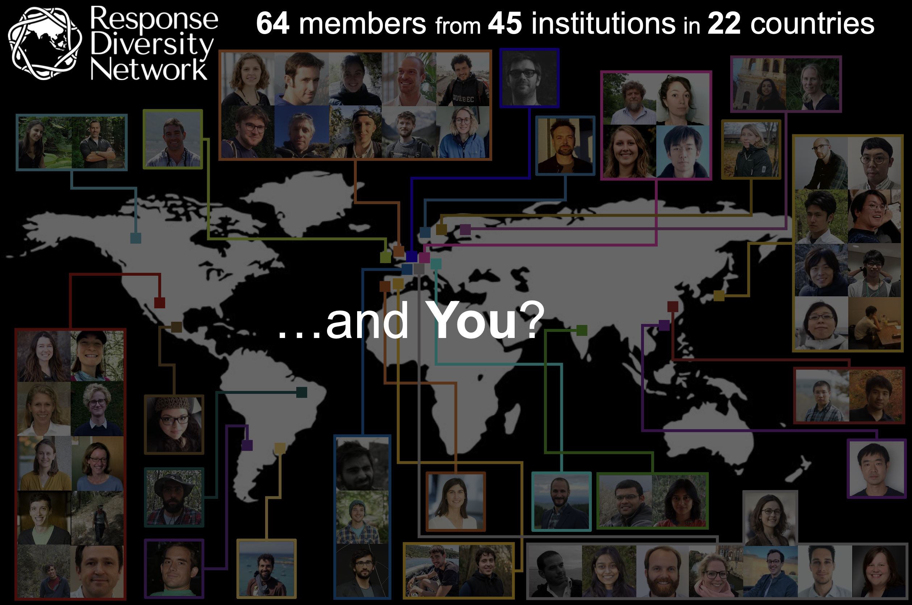

{fig-align="center" width="511"}

Membership is open to anyone interested in response diversity, at any career stage and from any discipline.

**[Join, update your details or leave on the membership page](https://responsediversitynetwork.github.io/rdn-members/join.html)**

On that page you can:

- **join** by filling in a short membership form (about five minutes, no sign-in needed), and choose whether you appear on the public member map and which details are shown;
- **update** your details at any time with the personal link you get after joining;
- **add, change or remove a photo** for the map;
- **leave** the network, which deletes your entry;
- find out about the RDN **mailing list**, and read how we handle your information in the **privacy notice**.

For any other enquiries, please contact any member of the Leadership Team.
